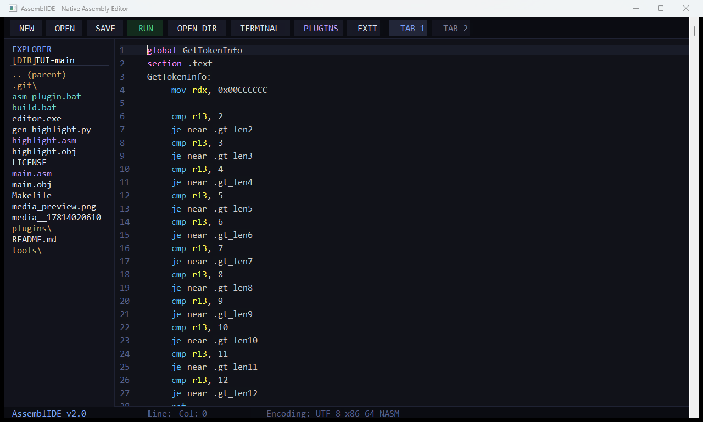

# AssemblIDE

A lightweight, high-performance native desktop code editor written in pure **x86-64 NASM Assembly** for Windows, built directly on Win32 and GDI APIs with zero C runtime (CRT) overhead.



---

## Overview

AssemblIDE is engineered from the ground up in raw 64-bit assembly (`main.asm`), communicating directly with the Windows kernel and subsystem libraries (`kernel32`, `user32`, `gdi32`, `comctl32`, `comdlg32`, `shell32`, `ole32`). It delivers near-instantaneous startup times, negligible memory consumption, and responsive editing without heavyweight frameworks or runtimes.

---

## Key Features

* **Pure x86-64 Assembly Engine:** Assembled using NASM for 64-bit Windows ABI. Minimal memory footprint (~10 MB) and instantaneous startup (<10 ms).
* **Modern Tokyo Night Theme & Double-Buffered GDI:** 
  * Custom dark color palette (`#1A1B26` background, `#16161E` sidebar, `#7AA2F7` accents, `#9ECE6A` strings, `#7DCFFF` keywords).
  * Smooth double-buffered GDI rendering preventing redraw flicker.
  * Real-time line numbering powered by native integer-to-string routines.
  * Active-line visual highlighting and dynamic scrollbar indicators.
* **Universal Syntax Highlighter:**
  * Real-time tokenization recognizing assembly directives, registers, and instructions alongside C and Python keywords.
  * Precompiled high-speed lookup tables generated via `gen_highlight.py` for zero-latency lexing.
* **Native File Tree & COM Directory Navigation:**
  * Built-in left sidebar file explorer for one-click file opening and directory traversal.
  * **`OPEN DIR`**: Integrates modern Windows COM `IFileOpenDialog` (`FOS_PICKFOLDERS`) to switch working directories on the fly.
* **Integrated Docked Terminal Panel:**
  * **`TERMINAL`**: Embeds an interactive Win32 console docked into the bottom panel.
  * Automatically synchronizes working directory to your current workspace for immediate build, test, and shell commands.
* **Multi-Buffer Tab Switching:**
  * Instant tab switching (`TAB 1` and `TAB 2`) utilizing fast 64-bit block transfers (`rep movsq`).
  * Seamlessly preserves cursor coordinates, scroll offsets, and edit buffers across tabs.
* **Sublime / VS Code Style Keybindings:**
  * `Ctrl + C` / `Ctrl + X`: Intelligently copies or cuts the entire line when no text selection is active.
  * `Ctrl + V`: Direct clipboard integration with native Win32 clipboard formats.
  * `Ctrl + Left / Right`: Token-aware cursor jumping across words and symbols.
  * `Ctrl + S`, `Ctrl + O`, `Ctrl + N`: Standard save, open, and new file shortcuts.
* **Extensible Plugin Market & Module CLI:**
  * Built-in plugin system (`asm-plugin.bat` and `tools/asm_plugin.py`) to discover, install, package, and import assembly extensions and themes.
  * Dedicated **`PLUGINS`** toolbar button to launch the market and inspect installed modules.

---

## Project Structure

```text
AssemblIDE/
├── main.asm             # Core application entry point, Win32 message loop & rendering
├── highlight.asm        # Fast token lookup & syntax parsing tables
├── gen_highlight.py     # Python utility to regenerate keyword & token tables
├── build.bat            # Automated NASM assembly and GCC linking script
├── asm-plugin.bat       # Wrapper for the AssemblIDE plugin CLI
├── tools/
│   └── asm_plugin.py    # Plugin management CLI (market, install, create, bundle)
├── plugins/
│   ├── plugins.inc      # Modular NASM include hooks for active plugins
│   ├── tokyo_night_theme/
│   └── git_status/
├── Makefile             # Alternative make configuration
├── LICENSE              # Open source license
└── README.md            # Project documentation
```

---

## Prerequisites

To assemble and build AssemblIDE from source, ensure you have:

1. **Windows 10 or 11 (x64)**
2. **[NASM (Netwide Assembler)](https://www.nasm.us/)** (version 2.14+ recommended, available in PATH)
3. **MinGW-w64 / GCC** (for 64-bit Windows linking)

---

## Building & Running

Assemble and link the native binary using the included `build.bat`:

```cmd
build.bat
```

To run the editor directly:

```cmd
editor.exe
```

---

## Plugin Management

AssemblIDE includes a built-in module manager for community extensions and custom themes:

```cmd
:: Browse available plugins
asm-plugin.bat market

:: Install a plugin
asm-plugin.bat install tokyo_night_theme

:: List installed plugins
asm-plugin.bat list

:: Create a new plugin template
asm-plugin.bat create my_custom_plugin
```

---

## Author & License

Developed by **Ryan Osacra** ([@DeltaEpiales](https://github.com/DeltaEpiales)).  
Licensed under the [MIT License](LICENSE).
